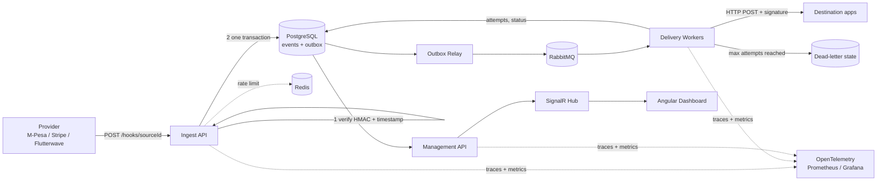
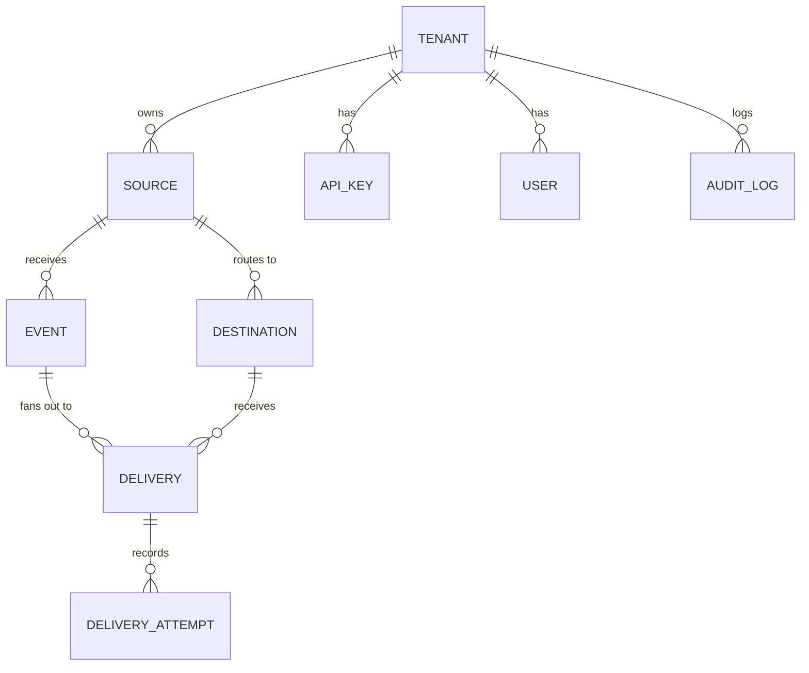

# HookGuard

> A reliable webhook gateway: **receive, verify, deduplicate, deliver at least once, and replay failures**, with live observability.

  

---

## Table of contents

1. [The problem](#1-the-problem)
2. [What HookGuard guarantees](#2-what-hookguard-guarantees)
3. [Architecture](#3-architecture)
4. [Tech stack and why](#4-tech-stack-and-why)
5. [Domain model and schema](#5-domain-model-and-schema)
6. [Key flows](#6-key-flows)
7. [API surface](#7-api-surface)
8. [Security model](#8-security-model)
9. [Repository layout](#9-repository-layout)
10. [Quick start](#10-quick-start)
11. [Testing strategy](#11-testing-strategy)
12. [Observability](#12-observability)
13. [Roadmap: phases and milestones](#13-roadmap-phases-and-milestones)
14. [Architecture Decision Records](#14-architecture-decision-records)
15. [Proof (benchmarks, coverage, screenshots)](#15-proof)
16. [Design trade-offs](#16-design-trade-offs)
17. [Git workflow and conventions](#17-git-workflow-and-conventions)
18. [Contributing and license](#18-contributing-and-license)

---

## 1. The problem

Payment providers (M-Pesa Daraja, Stripe, Flutterwave) notify merchants through webhook callbacks. Real systems lose or corrupt them through:

| Failure | Consequence |
|---|---|
| Merchant app is down or deploying | Event lost, order never marked as paid |
| Provider retries aggressively | Duplicate processing, double fulfilment |
| Forged or tampered request | Fraudulent "payment succeeded" |
| Out-of-order delivery | State machine corrupted (refund processed before payment) |
| Slow consumer | Provider times out and retries, amplifying load |

HookGuard sits **in front of** a client's application and absorbs all of this.

## 2. What HookGuard guarantees

| Guarantee | Mechanism |
|---|---|
| **Durable receipt** | Event persisted to the database *before* the provider receives a `2xx` |
| **Authenticity** | Per-source HMAC-SHA256 verification with timestamp tolerance (anti-replay) |
| **Deduplication** | Unique `(source_id, dedupe_key)` constraint; duplicates acknowledged but not re-processed |
| **At-least-once delivery** | Workers retry with exponential backoff and jitter |
| **No silent loss** | After N failures, events go to a dead-letter queue (DLQ) and stay inspectable |
| **Human recovery** | Replay any event or batch from the dashboard, with an audit trail |
| **Fast ack** | Ingest p95 target under 50 ms (persist, then process asynchronously) |

**Non-goals:** exactly-once delivery (impossible over an unreliable network; see [trade-offs](#16-design-trade-offs)), payload transformation pipelines, and acting as a general message broker.

## 3. Architecture



### Layering (Clean Architecture)

```
Domain          entities, value objects, domain rules (no dependencies)
Application     use cases, interfaces (IEventRepository, IClock, IDispatcher)
Infrastructure  EF Core, RabbitMQ, Redis, HTTP client, crypto implementations
Api / Workers   composition roots (ASP.NET Core host, BackgroundService host)
```

Dependencies point inward only. Domain and Application never reference EF Core, RabbitMQ or ASP.NET types. This is enforced by an architecture test (`NetArchTest`).

## 4. Tech stack and why

| Layer | Choice | Reason |
|---|---|---|
| Backend | C# .NET 10, ASP.NET Core minimal APIs | Strong typing, fast, `BackgroundService` for workers |
| ORM | EF Core + Npgsql | Migrations, plus raw SQL where needed (`FOR UPDATE SKIP LOCKED`) |
| Database | PostgreSQL | Partial indexes, `jsonb`, row-level locking primitives |
| Broker | RabbitMQ | Real broker semantics: acks, prefetch, DLX |
| Cache | Redis | Distributed rate limiting, short-lived idempotency fast path |
| Frontend | **Angular 20+** (standalone components, signals) + TypeScript | See [frontend decision](#frontend-decision-angular-vs-react) |
| Realtime | SignalR | First-class .NET + Angular client |
| Observability | OpenTelemetry, Serilog, Prometheus, Grafana | Traces, metrics, structured logs |
| Testing | xUnit, FluentAssertions, Testcontainers, Playwright, k6 | Unit to load coverage |
| DevOps | Docker Compose, GitHub Actions, Fly.io or a VPS | One-command demo, CI/CD |

### Frontend decision: Angular vs React

**Chosen: Angular.**

- **Depth beats breadth in a portfolio.** You are proficient in Angular, so you will spend your time on the hard parts (reliability, security) rather than learning a framework, and you can defend every line in an interview.
- **It matches the target market.** Enterprise and fintech teams running .NET backends (very common in Nairobi and Cape Town job listings) overwhelmingly pair them with Angular. The JD asks for "JavaScript frameworks", not React specifically.
- **The project is not an AI-chat UI.** React's real advantage in the current AI market is its ecosystem for AI front ends (Vercel AI SDK, streaming chat components). HookGuard's frontend is a data-dense, real-time operations dashboard, where Angular's structure (typed forms, DI, signals, RxJS for streams) is a strong fit.
- **Hedge:** keep the API contract clean (OpenAPI plus a generated TypeScript client) so a React port stays cheap, and mention that in the README. React skills can be shown later with a small second project.

## 5. Domain model and schema



| Table | Key columns | Notes |
|---|---|---|
| `tenants` | id, name, created_at | Isolation boundary |
| `users` | id, tenant_id, email, password_hash, role | Dashboard login (JWT) |
| `sources` | id, tenant_id, name, signing_secret_enc, tolerance_seconds, signature_scheme | Secret encrypted at rest |
| `destinations` | id, source_id, url, signing_secret_enc, max_attempts, timeout_ms, is_active | |
| `events` | id (uuidv7), source_id, dedupe_key, headers jsonb, payload bytea, received_at, signature_valid | **Unique `(source_id, dedupe_key)`** |
| `deliveries` | id, event_id, destination_id, status, attempt_count, next_attempt_at, last_error | Status: `Pending`, `InFlight`, `Succeeded`, `Failed`, `DeadLettered` |
| `delivery_attempts` | id, delivery_id, started_at, duration_ms, status_code, response_snippet, error | Powers the timeline |
| `api_keys` | id, tenant_id, key_prefix, key_hash, last_used_at, revoked_at | Only the hash is stored |
| `outbox_messages` | id, type, payload, created_at, published_at | Transactional outbox |
| `audit_log` | id, tenant_id, actor, action, target, metadata jsonb, at | Replay and config changes |

**Indexes worth documenting in the README** (with `EXPLAIN ANALYZE` output in `docs/db-notes.md`):

- `events (source_id, received_at DESC)` for the event list.
- Partial index `deliveries (next_attempt_at) WHERE status IN ('Pending')` for the due-work query.
- `outbox_messages (created_at) WHERE published_at IS NULL`.

## 6. Key flows

### 6.1 Ingest (hot path, target p95 < 50 ms)

```mermaid
sequenceDiagram
    participant P as Provider
    participant API as Ingest API
    participant R as Redis
    participant DB as PostgreSQL
    P->>API: POST /hooks/{sourceId} (body, signature, timestamp)
    API->>R: rate limit check
    API->>API: read raw body, verify HMAC (constant-time)
    API->>API: check timestamp within tolerance
    API->>DB: BEGIN; INSERT event ON CONFLICT DO NOTHING; INSERT deliveries + outbox; COMMIT
    alt duplicate
        API-->>P: 200 OK (duplicate=true)
    else new
        API-->>P: 202 Accepted
    end
```

Rules: verify against the **raw bytes** (never re-serialised JSON); reject before touching the database when the signature is invalid; return `2xx` only after commit.

### 6.2 Delivery

1. **Outbox relay** publishes unpublished `outbox_messages` to RabbitMQ, then marks them published (publisher confirms on).
2. **Worker** consumes a message, loads the delivery, and atomically claims it (`status = InFlight`).
3. Worker POSTs the payload to the destination with a fresh HookGuard signature and an `Idempotency-Key` header (so the destination can dedupe too).
4. `2xx` marks `Succeeded`. Anything else records an attempt and schedules `next_attempt_at`.
5. A **scheduler** sweep re-enqueues deliveries whose `next_attempt_at` has passed.
6. At `max_attempts`, status becomes `DeadLettered` and a metric and dashboard alert fire.

**Backoff:** `delay = min(cap, base * 2^attempt)`, then **full jitter**: `delay = random(0, delay)`. Unit-tested with an injected `IRandom` and `IClock`.

**Crash safety:** workers hold no state. If a worker dies mid-flight, a visibility timeout returns `InFlight` deliveries older than a threshold to `Pending`.

### 6.3 Replay

`POST /api/events/{id}/replay` and `POST /api/replays` (batch by filter) create **new delivery rows** for the same event (the original history is never mutated), write an `audit_log` entry, and enqueue via the outbox.

## 7. API surface

OpenAPI served by Scalar at `/scalar`; a TypeScript client is generated from the spec into `web/src/app/api`.

| Method | Route | Auth | Purpose |
|---|---|---|---|
| POST | `/hooks/{sourceId}` | HMAC | Ingest |
| POST | `/api/auth/login` | none | JWT for dashboard |
| GET | `/api/events` | JWT | Paged, filterable event list |
| GET | `/api/events/{id}` | JWT | Event detail and delivery timeline |
| POST | `/api/events/{id}/replay` | JWT | Replay one event |
| POST | `/api/replays` | JWT | Batch replay by filter |
| GET/POST/PUT | `/api/sources`, `/api/destinations` | JWT | Configuration |
| POST | `/api/keys` / DELETE `/api/keys/{id}` | JWT | Create and revoke API keys |
| GET | `/api/metrics/summary` | JWT | Success rate, p95, DLQ size |
| GET | `/health/live`, `/health/ready` | none | Probes |
| WS | `/hubs/events` | JWT | Live stream (SignalR) |

Errors use RFC 9457 `ProblemDetails`.

## 8. Security model

| Threat | Control |
|---|---|
| Forged webhooks | HMAC-SHA256 over `timestamp.body`, compared with `CryptographicOperations.FixedTimeEquals` |
| Replay attacks | Reject timestamps outside `tolerance_seconds`; dedupe key unique constraint |
| Stolen credentials at rest | API keys stored as hashes (shown once); signing secrets encrypted with a key from env/secret store |
| Brute force and abuse | Redis sliding-window rate limit per tenant and per source |
| Tenant data leakage | Every query filtered by `tenant_id`; integration test attempts cross-tenant reads |
| Secrets in the UI/logs | Masking middleware for `Authorization`, signature and secret-like headers and JSON keys |
| SSRF via destination URLs | Block private/loopback/link-local ranges after DNS resolution; HTTPS enforced outside dev |
| Dashboard auth | Short-lived JWT, refresh token rotation, password hashing with Argon2id or ASP.NET Identity hasher |
| Dependency risk | Dependabot plus `dotnet list package --vulnerable` and `npm audit` in CI |

An **OWASP Top 10 checklist** lives in `docs/security.md`, mapping each item to the control and the test that proves it.

## 9. Repository layout

```
hookguard/
├─ src/
│  ├─ HookGuard.Domain/            entities, value objects, domain services
│  ├─ HookGuard.Application/       use cases (MediatR or plain handlers), abstractions
│  ├─ HookGuard.Infrastructure/    EF Core, RabbitMQ, Redis, crypto, HTTP delivery client
│  ├─ HookGuard.Api/               ingest + management API, SignalR hub, auth
│  ├─ HookGuard.Workers/           outbox relay, delivery workers, scheduler
│  └─ HookGuard.FakeMerchant/      chaos simulator (configurable failure rate)
├─ web/                            Angular dashboard
│  └─ src/app/
│     ├─ core/                     auth, interceptors, generated API client
│     ├─ features/                 events, event-detail, sources, destinations, dlq, settings
│     └─ shared/                   ui components, pipes, a11y helpers
├─ tests/
│  ├─ HookGuard.UnitTests/
│  ├─ HookGuard.IntegrationTests/  Testcontainers: Postgres, RabbitMQ, Redis
│  ├─ HookGuard.ArchitectureTests/
│  ├─ e2e/                         Playwright (dashboard flows, axe a11y checks)
│  └─ load/                        k6 scripts
├─ docs/
│  ├─ architecture.md
│  ├─ runbook.md
│  ├─ security.md
│  ├─ db-notes.md
│  └─ adr/                         0001-... .md
├─ deploy/                         compose overrides, Fly.io config, Grafana dashboards
├─ docker-compose.yml
├─ .github/
│  ├─ workflows/ci.yml
│  ├─ workflows/release.yml
│  ├─ pull_request_template.md
│  └─ dependabot.yml
├─ .editorconfig  .gitignore  Directory.Build.props
├─ CONTRIBUTING.md  LICENSE  README.md
```

## 10. Quick start

```bash
git clone https://github.com/mburu1/HookGuard.git
cd HookGuard
cp .env.example .env
docker compose up --build
```

| Service | URL |
|---|---|
| Dashboard | http://localhost:4200 |
| API + Scalar docs | http://localhost:8080/scalar |
| Fake merchant | http://localhost:9000 |
| RabbitMQ UI | http://localhost:15672 |
| Grafana | http://localhost:3000 |

**Demo script (about 2 minutes):** open the dashboard, click **Send test traffic** (fires signed events at the ingest endpoint), watch the fake merchant fail about 30% of requests, see retries and recoveries live, open a dead-lettered event, and replay it.

## 11. Testing strategy

| Level | Tooling | What is proven |
|---|---|---|
| Unit | xUnit, FluentAssertions | HMAC verification (valid, tampered, wrong secret, stale timestamp), backoff and jitter bounds, status transitions |
| Integration | Testcontainers | Ingest persists before ack, duplicate delivery processed once, tenant isolation, outbox publishes after restart |
| Failure injection | Testcontainers + Toxiproxy or a stopped container | Kill the broker or destination mid-flight: no event lost, all eventually delivered |
| Architecture | NetArchTest | Domain has no outward dependencies |
| E2E and a11y | Playwright + axe-core | Key dashboard flows, zero critical axe violations, keyboard navigation |
| Load | k6 | Ingest throughput and p95 under sustained load |
| Mutation (optional) | Stryker.NET | Signature and backoff logic |

**Coverage target:** 80%+ on Domain and Application; coverage badge in CI.

## 12. Observability

- **Traces:** one trace per event: `ingest → persist → outbox → queue → delivery attempt`, with the `event_id` as a span attribute (W3C trace context propagated through RabbitMQ headers).
- **Metrics (Prometheus):** `hookguard_ingest_duration_seconds`, `hookguard_events_total{result}`, `hookguard_delivery_attempts_total{outcome}`, `hookguard_dlq_depth`, `hookguard_outbox_lag_seconds`.
- **Logs:** Serilog structured JSON with correlation IDs; secrets masked.
- **Health:** `/health/live` (process) and `/health/ready` (Postgres, Redis, RabbitMQ).
- **Dashboards:** provisioned Grafana board in `deploy/grafana`.
- **SLOs (documented in the runbook):** 99.9% of valid events durably stored; 99% delivered within 5 minutes when the destination is healthy.

## 13. Roadmap: phases and milestones

Estimates assume about 10 to 15 focused hours a week. **Each phase ends in something demonstrable**, so even a partly finished repo is a strong one. Mark milestones as you go.

### Phase 0: Foundations (Week 1)

- [x] **M0.1** Repo created, MIT license, `.editorconfig`, branch protection, PR template
- [x] **M0.2** Solution scaffolded with the five projects and project references enforcing layering
- [x] **M0.3** `docker-compose.yml` with Postgres, Redis, RabbitMQ; `/health` endpoint
- [x] **M0.4** CI skeleton: restore, build, test, lint on every PR
- [x] **M0.5** ADR 0001 (stack) and ADR 0002 (clean architecture) written

> Branch protection on `main` is a repository setting and still has to be enabled in GitHub
> (Settings → Branches): require a pull request, require the `build, test and lint` check.

**Done when:** a fresh clone runs `docker compose up` and CI is green.

### Phase 1: Core ingest and verification (Weeks 2 to 3)

- [ ] **M1.1** Domain: `Source`, `Event`, `SignatureVerifier`, `Clock` abstraction
- [ ] **M1.2** EF Core model, first migration, `events` unique index on `(source_id, dedupe_key)`
- [ ] **M1.3** `POST /hooks/{sourceId}`: raw-body read, HMAC verify, timestamp tolerance
- [ ] **M1.4** Persist-then-ack; duplicate returns `200` without re-processing
- [ ] **M1.5** Unit tests: valid, tampered, wrong secret, expired and future timestamps, constant-time compare
- [ ] **M1.6** Integration test: 100 concurrent identical deliveries produce exactly 1 stored event

**Done when:** you can `curl` a signed payload and see it stored once, and bad signatures get `401`.

### Phase 2: Reliability engine (Weeks 4 to 5)

- [ ] **M2.1** Transactional outbox + relay with publisher confirms
- [ ] **M2.2** RabbitMQ topology: work queue, prefetch, manual acks
- [ ] **M2.3** Delivery worker with typed `HttpClient`, timeouts, outgoing signature, `Idempotency-Key`
- [ ] **M2.4** Exponential backoff with full jitter (injected `IRandom` and `IClock`), unit tested
- [ ] **M2.5** Scheduler sweep for due retries and visibility-timeout recovery for stuck `InFlight`
- [ ] **M2.6** Dead-letter state after N attempts
- [ ] **M2.7** Failure-injection test: stop destination, send 1,000 events, restart destination, assert all 1,000 delivered and none duplicated by HookGuard

**Done when:** the failure-injection test passes in CI. This is your headline proof.

### Phase 3: Security and multi-tenancy (Week 6)

- [ ] **M3.1** Tenants, users, JWT auth with refresh rotation
- [ ] **M3.2** Hashed API keys (prefix + hash, shown once, revocable)
- [ ] **M3.3** Redis sliding-window rate limiting per tenant and source
- [ ] **M3.4** Encrypted signing secrets at rest; secret-masking middleware
- [ ] **M3.5** SSRF guard for destination URLs
- [ ] **M3.6** Audit log; cross-tenant isolation integration tests
- [ ] **M3.7** `docs/security.md` OWASP mapping

**Done when:** a cross-tenant read attempt test fails as expected and the OWASP table links to tests.

### Phase 4: Dashboard (Weeks 7 to 8)

- [ ] **M4.1** Angular workspace, strict TypeScript, generated API client, auth guard and interceptor
- [ ] **M4.2** Event list: server-side paging, filters (status, source, time), keyboard-accessible table
- [ ] **M4.3** Event detail: delivery timeline, request/response viewer with masking
- [ ] **M4.4** Replay (single and batch) with confirmation dialog and audit visibility
- [ ] **M4.5** Live stream via SignalR consumed as a signal/RxJS stream
- [ ] **M4.6** Metric cards: success rate, p95 latency, DLQ size, throughput sparkline
- [ ] **M4.7** Responsive layout (mobile to desktop), dark mode, WCAG 2.2 AA pass with axe and Lighthouse

**Done when:** Lighthouse accessibility score is 95+ and Playwright covers login, view, replay.

### Phase 5: Operations (Week 9)

- [ ] **M5.1** OpenTelemetry traces across ingest, outbox, queue, worker
- [ ] **M5.2** Prometheus metrics and a provisioned Grafana dashboard
- [ ] **M5.3** Serilog structured logging with correlation IDs
- [ ] **M5.4** k6 load tests (smoke, ramp, soak) with recorded results
- [ ] **M5.5** Full CI: build, unit, integration, e2e, coverage gate, container image publish to GHCR
- [ ] **M5.6** Deploy to Fly.io, Render or a VPS with a public demo URL

**Done when:** the README Proof section contains real numbers from your own runs.

### Phase 6: Polish and showcase (Week 10)

- [ ] **M6.1** `FakeMerchant` chaos simulator (configurable failure rate, latency, timeouts)
- [ ] **M6.2** "Send test traffic" button wired to the simulator
- [ ] **M6.3** Optional M-Pesa Daraja sandbox adapter (STK push callback payload mapping)
- [ ] **M6.4** Architecture diagram, runbook (common incidents and fixes), remaining ADRs
- [ ] **M6.5** Demo GIF, screenshots, 3-minute walkthrough video
- [ ] **M6.6** Tagged `v1.0.0` release with changelog

**Done when:** a stranger can clone, run one command, and understand what it does in under five minutes.

### Stretch goals

Per-source ordering keys, circuit breaker per destination, payload transformation rules, Stripe and Flutterwave signature presets, CLI tool (`hookguard replay --since 1h`), React dashboard port.

## 14. Architecture Decision Records

| ADR | Decision | Key trade-off |
|---|---|---|
| 0001 | Stack: .NET 10, PostgreSQL, RabbitMQ, Angular | Familiarity and market fit vs. trendier options |
| 0002 | Clean Architecture layering | More projects and ceremony vs. testability |
| 0003 | Persist-then-ack | Latency cost of a DB write vs. never losing an acknowledged event |
| 0004 | At-least-once delivery | Duplicates possible vs. impossible exactly-once |
| 0005 | Transactional outbox | Extra table and relay vs. dual-write inconsistency |
| 0006 | Postgres as source of truth, RabbitMQ as dispatcher | Two systems to run vs. DB-only queue throughput limits |
| 0007 | Full-jitter backoff | Slightly less predictable retries vs. avoiding thundering herds |
| 0008 | Raw-body signature verification | Must buffer the body vs. correctness |
| 0009 | SignalR for live updates | .NET-coupled vs. native integration |
| 0010 | Angular signals + RxJS split | Two paradigms vs. right tool for streams and state |

## 15. Proof

> Fill these in with **your own measured results**. Do not publish numbers you did not produce.

| Metric | Result | How measured |
|---|---|---|
| Ingest p50 / p95 / p99 | _TBD_ | k6, N VUs, hardware spec noted |
| Sustained ingest throughput | _TBD_ req/s | k6 ramp test |
| Events lost in failure-injection test | **0 of 1,000** | `tests/IntegrationTests/FailureInjection` |
| Duplicate-delivery test | 100 concurrent duplicates yields 1 event | integration test |
| Test coverage (Domain + Application) | _TBD_ % | CI coverage report |
| Lighthouse accessibility | _TBD_ | CI artifact |
| Axe critical violations | 0 | Playwright |

Add: a screenshot of the dashboard during a retry storm recovering, and the Grafana panel showing DLQ depth returning to zero after replay.

## 16. Design trade-offs

- **At-least-once, not exactly-once.** Exactly-once across a network boundary is not achievable without the destination's cooperation. HookGuard delivers at least once and sends a stable `Idempotency-Key` so the destination can dedupe. The duplicate window is documented.
- **Persist-then-ack.** Costs a database write on the hot path, but an acknowledged event is a durable event. This is the right default for payment data.
- **Outbox over dual write.** Writing to the DB and publishing to the broker separately can diverge on crash. The outbox makes the DB commit the single source of truth.
- **Ordering.** Parallel workers do not preserve order. Providers rarely guarantee it either. Consumers should use event timestamps/versions; per-key ordering is a stretch goal.
- **Postgres as a work queue.** `FOR UPDATE SKIP LOCKED` is viable at this scale and removes broker risk, but RabbitMQ is kept to demonstrate real broker semantics. ADR 0006 records the reasoning.
- **Payload storage.** Payloads are stored as raw bytes for signature fidelity; retention and PII handling are documented in the runbook (configurable TTL job).

## 17. Git workflow and conventions

- **Branches:** `main` (protected, always releasable) and short-lived `feat/…`, `fix/…`, `docs/…`, `chore/…`.
- **Commits:** [Conventional Commits](https://www.conventionalcommits.org/), for example `feat(ingest): verify HMAC against raw body`.
- **PRs to yourself:** every milestone is a PR with a template (summary, screenshots, test evidence, risks, checklist). Squash merge.
- **Self-review:** leave review comments on your own PRs for non-obvious decisions. Reviewers can see how you think.
- **Issues and milestones:** GitHub Issues per milestone ID (M1.3, M2.4, ...) on a Projects board.
- **CI gates:** build, tests, coverage threshold, lint (`dotnet format`, ESLint), vulnerability scan.
- **Releases:** semantic versioning, tags, GitHub Releases with changelog.

## 18. Contributing and license

See [CONTRIBUTING.md](CONTRIBUTING.md). Licensed under the [MIT License](LICENSE).
